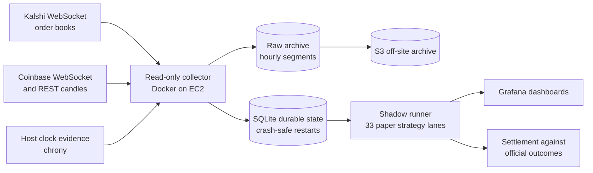

# Event-Market Quant Bot (public edition)

A personal quantitative research project on [Kalshi](https://kalshi.com) prediction markets, built between August and September 2026. It asks one question as rigorously as possible: **can a careful retail participant find an edge that survives real trading costs?**

The short answer is no, and the way it got there is the point of this repository. The project built a forecasting model that beat Kalshi's own prices on four separate untouched test sets, then showed that the improvement disappears after spread, fees and liquidity. A broad search of eleven other directions found the same thing: every inefficiency was real, and each was sized at or below the cost of trading it.

> **Research only.** The system is read-only by design and never placed a real order. Nothing here is investment advice, and no result here establishes profitability.

## Highlights

| | |
| --- | --- |
| **Forecasting model** | One-parameter BTC spot-distance adjustment to Kalshi's price. Log loss 69-80% lower than the market's on a 750-event locked test and three fresh 500-event cohorts, winning 20 of 20 chronological test blocks |
| **Validation discipline** | Every model, split and evaluator was fingerprinted before outcomes were opened; five earlier candidates and rules were rejected by the same gates |
| **Economics** | Every strategy built on the model (six preregistered attempts) failed or was inconclusive after exact fees and conservative fills |
| **Live system** | Read-only AWS deployment (EC2, Docker, S3) streaming Kalshi and Coinbase WebSockets, with clock-health gates, crash-safe restarts, a 33-lane shadow simulator and Grafana dashboards |
| **Edge search** | 177,450 arbitrage relations over 38,484 markets, 2.33M real trades for market making, sports and weather mispricing: eleven directions closed |
| **Testing** | About 1,900 automated tests |
| **Self-correction** | Six documented cases where a weighted metric faked an edge, and one retracted finding of my own |

## Start here

1. **[docs/RESEARCH_HISTORY.md](docs/RESEARCH_HISTORY.md)**: the whole project in twelve phases, with results and links to the evidence.
2. **[docs/KALSHI_EDGE_SEARCH_CLOSEOUT.md](docs/KALSHI_EDGE_SEARCH_CLOSEOUT.md)**: the final edge search and the methodological lessons.
3. **[docs/KXBTCD_CANDIDATE_E_H3_HISTORICAL_LOCKED_TEST.md](docs/KXBTCD_CANDIDATE_E_H3_HISTORICAL_LOCKED_TEST.md)**: the model's locked-test result.
4. **[docs/LEARNING_GUIDE.md](docs/LEARNING_GUIDE.md)**: the statistics and market mechanics behind it all, written as a workbook.

## The model in one line

```
logit(p) = logit(q_market) + beta * d_BTC,     d_BTC = 10,000 * ln(S_t / K)
```

Kalshi's KXBTCD markets ask whether Bitcoin will be above a strike `K` at a set time. The model keeps the market's own probability `q_market` as its anchor and adds one term: how far the live Coinbase price `S_t` sits from the strike.

| Test set (untouched until frozen) | Events | Market log loss | Model log loss | Blocks won |
| --- | --- | --- | --- | --- |
| H3 locked test | 750 | 0.1379 | 0.0389 | 5/5 |
| C1 fresh cohort | 500 | 0.1708 | 0.0532 | 5/5 |
| C2 fresh cohort | 500 | 0.1676 | 0.0506 | 5/5 |
| C3 fresh cohort | 500 | 0.1210 | 0.0237 | 5/5 |

Kalshi's quotes lag the spot price, and one term corrects most of that lag. But the model's edge is largest where the order book is thinnest, and where there is liquidity the edge after spread and fees is roughly zero. [Phase 10 of the research history](docs/RESEARCH_HISTORY.md#phase-10---turning-candidate-e-into-a-strategy-aug-18---sep-3) shows how each strategy attempt failed.

## Live system architecture



Stale feeds, sequence gaps, unhealthy clock evidence and ambiguous state block readiness instead of producing a signal. Every API response is archived before transformation, and every derived row carries its raw lineage.

## Repository map

| Path | Contents |
| --- | --- |
| `src/` | Library code: collectors, transports, lineage and manifests, feature contracts, model fitting and evaluation, strategy simulators, soak runtime, shadow runner, dashboard exports |
| `tests/` | The automated test suite, including synthetic fixtures |
| `configs/` | Frozen predeclarations, evaluator freezes, model coefficients and source registry, each with its fingerprint |
| `docs/` | The research record: charter, schemas, preregistrations, results, decisions and the experiment log |
| `deploy/` | Docker, Compose, Grafana provisioning and archive scripts for the AWS read-only soak |
| `scripts/kalshi_research/` | Standalone, standard-library scripts from the edge search |
| `scripts/checkpoint_closeout.py` | The fail-closed Git checkpoint tool (validates, tests, scans for secrets, commits, verifies sync) |
| Root `*.py` | Research entry points (collectors, analyses, validators) that the library and tests depend on |

## Running the tests

```bash
python -m venv .venv
source .venv/bin/activate          # Windows: .\.venv\Scripts\Activate.ps1
pip install -r requirements.txt pytest
python -m pytest -q
```

A handful of tests validate frozen artifacts produced from private market data (`data/` is not published) and will fail or skip without it. No credentials are needed to run the suite. See [docs/PLATFORM_QUICKSTART.md](docs/PLATFORM_QUICKSTART.md) for the original setup and safety notes.

## What is not in this repository

- **Market data and logs** (about 36 GB of raw archives), which are large and come from Kalshi's API.
- **Credentials.** Only `.env.example` with placeholders is included.
- **About 230 one-off checkpoint scripts** that wrote a single freeze, receipt or documentation update. Their results are recorded in `docs/` and `configs/`.
- **Internal planning files** (backlog, AI-assistant handoff notes). Some documents still mention them by name.

## How it was built

I set the research questions, designed the preregistration and validation gates, and judged every result. Most of the code was written with AI coding assistants (ChatGPT and Codex through early September, then Claude Code), which let one person run a program of this size in about two months. The decision log ([docs/DECISIONS.md](docs/DECISIONS.md)) and experiment log ([docs/EXPERIMENT_LOG.md](docs/EXPERIMENT_LOG.md)) record each step as it happened.

## License

MIT for the code. The documentation is shared for reference.
